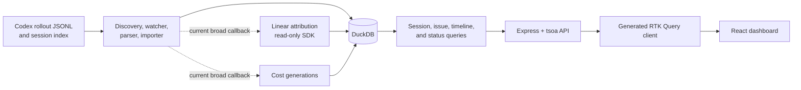
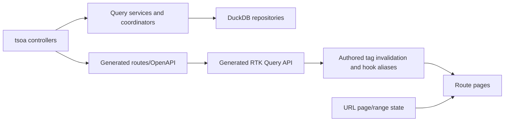

# Cartodex Map

> Auto-generated by Cartodex, a Codex port inspired by Cartographer. Last mapped: 2026-09-30T19:47:21Z

## System Overview

AI Task Observer is a local-first npm workspace that ingests Codex Desktop activity and presents
usage through a React dashboard. The Node/Express backend is the only reader of Codex source files
and the only DuckDB writer. It follows append-only session records, derives normalized usage and
cost facts, currently maintains optional Linear attribution, and publishes a generated OpenAPI
contract. The frontend consumes that contract through a generated RTK Query client and presents
overview, issue, session, phase-filter, and operational-status views.



The backend serializes writes through `AppDatabase.exclusiveWrite()` and uses explicit SQL
transactions for multi-step mutations. Counts and monetary values remain exact decimal strings at
the API and UI boundaries. Selected explicit user/assistant message content may be persisted in
structured event rows, but reasoning, tool arguments/results, credentials, opaque records,
malformed payloads, source paths, and transcripts are not exposed.

The repository-wide audit treats automatic Linear attribution, broad post-ingestion callbacks,
full-history cost snapshots, and persistence-model boundaries as findings to reassess for the MVP.
Audit documents describe current behavior and accepted review decisions; they are not
implementation plans.

## Directory Structure

```text
.
├── backend/
│   ├── src/api/            authored controllers/models plus generated tsoa routes
│   ├── src/config/         validated environment configuration
│   ├── src/database/       DuckDB lifecycle, migrations, models, repositories
│   ├── src/modules/        sessions, Linear, pricing, issue, and timeline services
│   ├── src/server.ts       backend composition root and process lifecycle
│   ├── generated/          generated OpenAPI document
│   └── __tests__/          API, module, repository, migration, and E2E tests
├── frontend/
│   ├── src/app/            providers, store, shell, and routes
│   ├── src/api/            generated client plus authored cache behavior
│   ├── src/features/       overview, issues, sessions, and operations
│   ├── src/components/ui/  shared UI primitives
│   ├── src/lib/            exact formatters, URL state, and API errors
│   ├── __tests__/          Bun/RTL/happy-dom tests mirroring source areas
│   └── e2e/                intercepted Playwright dashboard flows
├── openspec/
│   ├── specs/              canonical product and architecture requirements
│   └── changes/            active and archived spec-driven changes
├── docs/
│   ├── CARTODEX_MAP.md     generated repository navigation
│   └── audit/              English repository-wide audit and per-model reviews
├── scripts/                generated-file, alias, and backend smoke verification
├── .agents/skills/         repository-local Codex workflow skills
├── package.json            workspace orchestration and verification pipeline
└── AGENTS.md               contributor and agent conventions
```

## Module Guide

### Workspace Tooling and Contracts

**Purpose**: Coordinates the two npm workspaces, API generation, verification, CI, and local
development. Node 24 is the runtime; the npm-installed Bun binary is used for tests.

**Entry point**: `package.json`

**Key files**:

| File                       | Purpose                                                     | Tokens |
| -------------------------- | ----------------------------------------------------------- | -----: |
| `package.json`             | Root scripts and workspace definitions                      |    459 |
| `README.md`                | Product, operations, data boundaries, and development guide |   2736 |
| `scripts`                  | Generated-file, import-alias, and backend smoke checks      |   2328 |
| `.github/workflows/ci.yml` | Locked install and full verification pipeline               |    197 |
| `.agents/skills`           | Cartodex, OpenSpec, handoff, and linking workflows          |  19158 |

**Exports**: `npm run dev`, `generate:api`, `test`, `build`, and `verify`. API generation runs
backend tsoa/OpenAPI generation before frontend RTK Query generation.

**Dependencies**: npm workspaces, TypeScript, ESLint, Prettier, Bun, and `concurrently`.

**Dependents**: Both applications, CI, smoke tests, and repository-local skills.

### Backend Composition and HTTP API

**Purpose**: Validates configuration, opens and migrates DuckDB, constructs background workers and
query services, starts Express, and exposes the HTTP contract through thin tsoa controllers.

**Entry point**: `backend/src/server.ts`

**Key files**:

| File                          | Purpose                                                                | Tokens |
| ----------------------------- | ---------------------------------------------------------------------- | -----: |
| `backend/src/server.ts`       | Composition root, startup order, notifications, graceful shutdown      |   2168 |
| `backend/src/app.ts`          | Listener-free Express application for runtime and tests                |    175 |
| `backend/src/config`          | Immutable Zod-validated environment configuration                      |   1403 |
| `backend/src/api/controllers` | Authored health, import, session, Linear, cost, issue, timeline routes |   2819 |
| `backend/src/api/models`      | JSON-safe request and response contracts                               |   2456 |
| `backend/src/api/generated`   | Generated tsoa route registration; do not edit                         |  12660 |
| `backend/generated`           | Generated OpenAPI document; do not edit                                |  12002 |

**Exports**: Health; import status/rescan; session list/detail/relink/phase; Linear status/sync;
issue usage list/detail; phase-filtered 12h/24h usage timeline; and cost
status/recalculation endpoints.

**Dependencies**: Express 5, tsoa, Pino, Zod, DuckDB repositories, and module coordinators/query
services.

**Dependents**: The generated frontend client, Supertest suites, and the compiled smoke test.

### Session Ingestion and Queries

**Purpose**: Discovers Codex JSONL files, follows complete appended records, reconciles optional
session-index titles, normalizes usage observations, persists permitted events, and builds
JSON-safe session read models and explicit phase assignments.

**Entry point**: `backend/src/modules/sessions/coordinator.ts`

**Key files**:

| File                                          | Purpose                                                                  | Tokens |
| --------------------------------------------- | ------------------------------------------------------------------------ | -----: |
| `backend/src/modules/sessions`                | Discovery, source reading, parsing, importing, watching, queries, phases |  16154 |
| `backend/src/modules/sessions/coordinator.ts` | Initial scan, Chokidar events, recovery sweeps, debounce/run state       |   4782 |
| `backend/src/modules/sessions/parser.ts`      | Record selection and cumulative-token normalization                      |   3871 |
| `backend/src/modules/sessions/importer.ts`    | Checkpointed append or full rebuild workflow                             |   1875 |

**Exports**: `IngestionCoordinator`, `CodexSourceImporter`, `parseCodexRecords()`,
`SessionQueryService`, and `SessionPhaseService`.

**Dependencies**: Chokidar, filesystem readers, the session index reader, and
`CodexIngestionRepository`.

**Dependents**: Server lifecycle, import/session controllers, Linear notifications, cost
recalculation, and issue/timeline aggregates.

`CodexIngestionRepository.applySourceChunk()` is the atomic boundary for session metadata,
session events, usage observations, per-session derived usage, the merged source checkpoint, and
import-run progress. The checkpoint carries source compatibility, committed offset, `session_id`,
`active_model`, the `baseline_input`/`baseline_cached_input`/`baseline_output` columns,
`normalization_epoch`, `next_record_number`, status, diagnostics, and timestamps. Source paths
remain present on events, observations, and checkpoints.

### Linear Attribution

**Purpose**: Extracts exact issue candidates from titles, caches minimal Linear issue metadata,
maintains sticky session links, and supports explicit atomic relinking. Linear access is optional
and read-only.

**Entry point**: `backend/src/modules/linear/coordinator.ts`

**Key files**:

| File                                        | Purpose                                                                 | Tokens |
| ------------------------------------------- | ----------------------------------------------------------------------- | -----: |
| `backend/src/modules/linear`                | Attribution state, title parsing, SDK adapter, sync and relink services |   7054 |
| `backend/src/modules/linear/coordinator.ts` | Cached, bounded, coalesced reconciliation                               |   3511 |

**Exports**: `AttributionCoordinator`, `LinearSdkIssueReader`, title parsing/state helpers, and
`SessionRelinkService`.

**Dependencies**: Official Linear SDK, session records, cached issue/attribution/run repositories,
and DuckDB transactions.

**Dependents**: Session projections, issue usage, Linear controllers, and the operations UI.

### Pricing, Issue Usage, and Timeline

**Purpose**: Loads a versioned pricing catalog, prices observation snapshots with exact arithmetic,
stores immutable calculation generations, and maps issue/session/model/day or global hourly
aggregates into API responses.

**Entry point**: `backend/src/modules/pricing/coordinator.ts`

**Key files**:

| File                                 | Purpose                                                              | Tokens |
| ------------------------------------ | -------------------------------------------------------------------- | -----: |
| `backend/src/modules/pricing`        | Catalog validation, exact calculator, generation service/coordinator |   5852 |
| `backend/src/modules/issues`         | Issue usage response mapping                                         |    911 |
| `backend/src/modules/usage-timeline` | 12h/24h range, phase validation, and timeline mapping                |   1636 |
| `backend/config/models.json`         | Versioned model aliases and USD pricing periods                      |    363 |

**Exports**: Pricing catalog/domain/calculator APIs, `CostCalculationService`,
`CostCalculationCoordinator`, `IssueUsageQueryService`, and `UsageTimelineQueryService`.

**Dependencies**: Usage observations, exact decimal helpers, cost/issue/timeline repositories, and
the configured catalog.

**Dependents**: Cost, issue usage, session, and timeline API responses and dashboard views.

Cost calculation currently snapshots every observation into every completed generation. Timeline
status also hashes a full observation snapshot to determine freshness, while timeline aggregation
materializes selected raw facts in Node before building buckets.

### DuckDB Persistence

**Purpose**: Owns the sole write boundary, schema evolution, row/domain conversion, transactional
ingestion, attribution state, cost generations, and aggregate SQL.

**Entry point**: `backend/src/database/database.ts`

**Key files**:

| File                                                              | Purpose                                            | Tokens |
| ----------------------------------------------------------------- | -------------------------------------------------- | -----: |
| `backend/src/database/migrations`                                 | Checksummed schema and phase-assignment migrations |   4060 |
| `backend/src/database/models`                                     | Row types and timestamp/date/decimal mappings      |   7205 |
| `backend/src/database/repositories`                               | Parameterized mutations and aggregate queries      |  18093 |
| `backend/src/database/repositories/codex-ingestion-repository.ts` | Atomic source-chunk persistence                    |   2071 |
| `backend/src/database/repositories/issue-usage-repository.ts`     | Latest-generation usage aggregates                 |   3005 |
| `backend/src/database/repositories/usage-timeline-repository.ts`  | Phase-filtered facts and zero-filled buckets       |   2010 |

**Exports**: `AppDatabase`, migration functions, row mappers, and repositories.

**Dependencies**: `@duckdb/node-api`, SQL migrations, and backend domain types.

**Dependents**: All backend coordinators and query services. No frontend or skill writes DuckDB
directly.

### Frontend Application and API State

**Purpose**: Provides the persistent desktop dashboard shell, route ownership, RTK Query store,
generated-client boundary, exact metric presentation, and explicit mutation workflows.

**Entry point**: `frontend/src/main.tsx`

**Key files**:

| File                         | Purpose                                                   | Tokens |
| ---------------------------- | --------------------------------------------------------- | -----: |
| `frontend/src/app`           | Providers, RTK Query store, shell, and route definitions  |    907 |
| `frontend/src/api`           | Generated client and authored cache-tag/hook layer        |   3833 |
| `frontend/src/api/generated` | Generated OpenAPI RTK Query client; do not edit           |   3409 |
| `frontend/src/components/ui` | Shared shadcn-style primitives and warning tooltip        |   1482 |
| `frontend/src/lib`           | Exact formatting, range/phase URL state, sanitized errors |   2599 |

**Exports**: `/overview`, `/issues`, `/issues/:issueId`, and `/sessions`; `/` redirects to
`/overview`. `dashboard-api.ts` exports the application-facing query and mutation hooks. Overview
range and current-session phase filters are URL-owned.

**Dependencies**: React 19, React Router 7, Redux Toolkit/RTK Query, Radix primitives, Recharts,
Tailwind, and the generated OpenAPI client.

**Dependents**: Browser users, component tests, and Playwright flows.

### Frontend Features

**Purpose**: Renders recent usage, issue aggregates, session attribution, and operational controls
while preserving nullability, completeness, coverage, anomaly, and pricing-gap states.

**Entry point**: `frontend/src/app/route-config.tsx`

**Key files**:

| File                               | Purpose                                                      | Tokens |
| ---------------------------------- | ------------------------------------------------------------ | -----: |
| `frontend/src/features/overview`   | Recent counters, charts, range/phase controls, hourly table  |   4327 |
| `frontend/src/features/issues`     | Paginated list, detail tables, metrics, warning descriptions |   3192 |
| `frontend/src/features/sessions`   | Paginated sessions and explicit relink confirmation          |   1635 |
| `frontend/src/features/operations` | Import, Linear, and cost status/actions                      |   2324 |

**Exports**: Route-page components and shared issue metric presentation.

**Dependencies**: Dashboard API hooks, URL search parameters, exact-string formatters, and shared UI
components.

**Dependents**: The application route tree and feature tests.

The current frontend has no 90-day range, daily timeline buckets, overview model breakdown, or
phase-comparison visualization. Those remain active plans rather than implemented behavior.

### Audit Documentation

**Purpose**: Records repository-wide audit evidence, accepted decisions, open questions, and
per-model reviews before new simplification work is proposed.

**Entry point**: `docs/audit/README.md`

**Key files**:

| File                                      | Purpose                                      | Tokens |
| ----------------------------------------- | -------------------------------------------- | -----: |
| `docs/README.md`                          | Documentation entry point                    |    143 |
| `docs/audit/README.md`                    | Audit objective, method, inventory, workflow |    608 |
| `docs/audit/data-models/codex-session.md` | First persistence-model audit                |    521 |
| `docs/audit/data-models/TEMPLATE.md`      | Repeatable model-review structure            |    274 |

**Exports**: Current-behavior descriptions, evidence, decision ledger, model classifications, and
audit-to-OpenSpec workflow.

**Dependencies**: Current source code, development-database measurements, canonical specs, active
change artifacts, and the Cartodex map.

**Dependents**: Future model audits and independently scoped OpenSpec simplification changes.

### Tests and Specifications

**Purpose**: Captures regression behavior at service, database, HTTP, component, and browser levels;
canonical OpenSpec files define the intended system while active changes refine it.

**Entry point**: `npm test`; canonical requirements begin in `openspec/specs/`.

**Key files**:

| File                         | Purpose                                                          | Tokens |
| ---------------------------- | ---------------------------------------------------------------- | -----: |
| `backend/__tests__`          | Bun, Supertest, repository, migration, and server E2E coverage   |  70239 |
| `backend/__tests__/modules`  | Parser/importer/coordinator, pricing, Linear, and query behavior |  29171 |
| `backend/__tests__/database` | SQL aggregation, migration, timestamp, and write-gate behavior   |  15356 |
| `frontend/__tests__`         | Bun/RTL/happy-dom API, route, feature, and formatter coverage    |  12814 |
| `frontend/e2e`               | Intercepted Chromium dashboard flows at 1024×768                 |   2406 |
| `openspec/specs`             | Nine canonical capability specifications                         |  22483 |
| `openspec/changes`           | Active and archived spec-driven change artifacts                 | 113663 |
| `openspec/changes/archive`   | Historical completed changes                                     |  83837 |
| `openspec/config.yaml`       | OpenSpec project context and artifact rules                      |    379 |

**Exports**: Executable regression suites, canonical requirements, delta specs, designs, proposals,
and task lists.

**Dependencies**: Bun, Supertest, React Testing Library, happy-dom, Playwright, and the current source
tree.

**Dependents**: `npm run verify`, CI, reviewers, and OpenSpec implementation/archive workflows.

## Data Flow

### Ingestion, attribution, and pricing

1. The ingestion coordinator discovers configured roots, reads the optional session index, starts
   Chokidar watchers, and periodically recovers notifications that may have been missed.
2. The source reader classifies each file as new, append, unchanged, or rebuild from its identity,
   committed byte offset, prefix, and parser version. Only newline-complete records advance a
   checkpoint.
3. The parser tracks the active model and cumulative-token baseline, emitting normalized usage
   observations, session metadata, and permitted structured events.
4. `CodexIngestionRepository.applySourceChunk()` obtains the FIFO exclusive-write gate and performs
   an explicit transaction. Rebuilds replace source-owned facts and checkpoint continuation while
   preserving stable session attribution; touched session summaries are recomputed before commit.
5. A generic callback currently notifies Linear and queues cost recalculation after source imports
   and title-index changes. It does not distinguish metadata, messages, titles, and usage facts.
6. Pricing hashes a stable observation snapshot with the catalog content hash and calculator
   version, writes a generation and items, then atomically marks it complete or failed. Query paths
   consume only the latest completed generation and report uncovered/partial states explicitly.

### API and frontend



RTK Query owns remote state. Pagination (`page`), overview range (`range=12h|24h`), and current
session phase are URL-owned. Relink confirmation remains local to the initiating session card.

## Conventions

- TypeScript is strict. Use kebab-case filenames, PascalCase React components, and camelCase
  functions.
- Use `@/` for imports crossing source directories and `./` within the same directory. Parent
  imports are rejected by verification.
- Prettier enforces semicolons, double quotes, trailing commas, 100-column lines. ESLint permits no
  warnings.
- Controllers remain thin; persistence and aggregation SQL remain in repositories.
- Backend writes use `AppDatabase.exclusiveWrite()`; multi-step operations additionally use
  explicit transactions and rollback.
- Bigints and exact costs stay as bigint/decimal internally and decimal strings across JSON.
  Cached input is a subset of input, not an additional contribution to total tokens.
- DuckDB TIMESTAMPTZ values map through epoch microseconds; DATE values map to UTC calendar dates.
- Tests mirror source layout and use `*.test.ts`/`*.test.tsx`; UI E2E tests intercept `/api/*`.
- Initial loading, cached refresh, empty success, incomplete data, and request failure are distinct
  states. API errors shown to users are sanitized.
- OpenSpec canonical specs describe shipped requirements; active change directories may contain
  completed implementation artifacts awaiting archival as well as planned work.

## Gotchas

- Never hand-edit `backend/generated/`, `backend/src/api/generated/`, or
  `frontend/src/api/generated/`; run `npm run generate:api`. `verify-generated` regenerates files
  before comparing hashes, so it can modify stale artifacts.
- `api/dependencies.ts` holds a module-level dependency singleton. Constructing another app with API
  dependencies replaces it, which matters in focused tests.
- Pricing is validated before the database or listener starts. Migration failures close the
  database without starting background coordinators.
- Applied migration checksums are immutable. The production build copies SQL migrations into
  `dist`, replacing that destination directory.
- Incremental ingestion advances only through complete records. Truncation, replacement, identity
  changes, or parser-version changes force a rebuild; failed rebuilds preserve a stale prior
  snapshot.
- The merged import checkpoint stores parser continuation, including the active model, token
  baselines, normalization epoch, and next record number. There is no separate parser-state table;
  the normalization epoch remains on observations across appends and restarts.
- Usage category totals become unavailable when required observations are incomplete. Pricing may
  still expose a partial known cost while `costComplete` is false.
- Timeline observations without event time are excluded from buckets but counted as unknown-time
  facts. Empty hourly buckets are zero-filled; daily issue buckets use UTC.
- The generic post-ingestion callback can trigger Linear and cost work for title-only or non-usage
  changes. Automatic Linear attribution is outside the revised MVP direction.
- Completed cost generations are full-history snapshots, and cost freshness checks hash all
  observations. Both are audit targets before rollup work resumes.
- Linear title candidates do not silently move an existing link. Explicit relink is required, and
  session-index title changes do not rewrite rollout usage facts.
- The frontend intentionally supports desktop widths from 1024 CSS pixels; narrower layouts are
  outside scope. It never reads Codex files, DuckDB, or Linear directly.
- The generated API includes the phase mutation, but the authored frontend hook/UI intentionally
  does not expose phase editing yet.
- Active OpenSpec change status is inferred from task checkboxes; `package-local-deployment` is the
  clearly unfinished planned change in the scanned tree.

## Navigation Guide

**To change session parsing or supported Codex record shapes**: start with
`backend/src/modules/sessions/parser.ts` and its parser fixtures/tests, then inspect importer rebuild
semantics, parser versioning, migrations, and canonical ingestion/event specs.

**To change file watching, checkpoints, or missed-update recovery**: inspect session
`coordinator.ts`, `source-reader.ts`, `importer.ts`, `codex-checkpoint-repository.ts`, and their
coordinator/importer/repository tests.

**To change Linear matching or relinking**: inspect `backend/src/modules/linear/`, the issue and
attribution repositories, Linear controller/model contracts, and session/operations UI consumers.

**To change pricing or cost completeness**: inspect `backend/config/models.json`, pricing domain,
catalog, calculator, generation service/repository, then issue/session/timeline projections and
frontend exact-string formatters.

**To add or change an API endpoint**: edit an authored controller and response model, wire its
service in `server.ts`/`api/dependencies.ts`, add HTTP tests, run `npm run generate:api`, then update
the authored frontend cache-tag/hook layer.

**To change issue or timeline aggregation**: start in the corresponding database repository, then
the query service/API model, generated contract, frontend presentation, and canonical OpenSpec.

**To add a dashboard route or page**: update `frontend/src/app/route-config.tsx`, the persistent
shell/navigation if needed, the appropriate feature directory, RTK Query tags/hooks, route tests,
and intercepted Playwright flows.

**To change operational controls**: inspect `frontend/src/features/operations/`, backend status and
action controllers/coordinators, invalidation tests, and the usage-dashboard spec.

**To understand current requirements or planned changes**: read the relevant file under
`openspec/specs/`, then inspect matching non-archived `openspec/changes/`. Treat archived changes as
historical context rather than the canonical source.

**To continue the application audit**: start at `docs/audit/README.md` and keep each model review
bounded to current behavior, decisions, and open questions.
