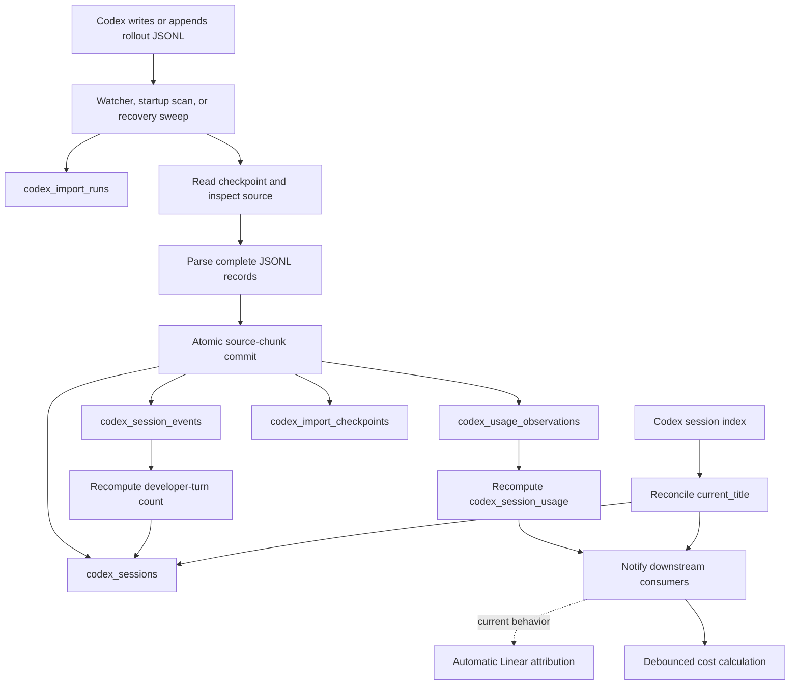

# Codex Session Ingestion Flow

## Current Flow

## What Happens for a New Session

1. Codex creates a rollout JSONL file under a configured root.
2. Startup discovery, the file watcher, a manual rescan, or recovery rediscovery queues the file.
3. The importer checks `codex_import_checkpoints` to choose no-op, append, or rebuild.
4. Complete JSONL records are parsed into session metadata, selected events, usage observations, and
   parser continuation values.
5. One transaction writes those facts, the merged source checkpoint, session summaries, and import
   progress.
6. The committed session IDs currently trigger automatic Linear attribution and a debounced cost
   calculation. Automatic attribution is already outside the accepted MVP direction.
7. The separate Codex session index may later update only `codex_sessions.current_title`.

## Tables in the Transaction

| Table                      | Current responsibility                                                                                                                                                                                             |
| -------------------------- | ------------------------------------------------------------------------------------------------------------------------------------------------------------------------------------------------------------------ |
| `codex_sessions`           | Stable session identity and session-level metadata                                                                                                                                                                 |
| `codex_session_events`     | Selected message, model-context, and token events                                                                                                                                                                  |
| `codex_usage_observations` | Normalized token facts used by timelines and pricing                                                                                                                                                               |
| `codex_import_checkpoints` | Source compatibility, committed offset, `session_id`, `active_model`, `baseline_input`/`baseline_cached_input`/`baseline_output`, `normalization_epoch`, `next_record_number`, status, diagnostics, and timestamps |
| `codex_session_usage`      | Recomputed per-session token summary                                                                                                                                                                               |

`codex_import_runs` is updated around this transaction as operational run history.

Migration 003 validates checkpoint/continuation pairs by source path, source identity, parser
version, and existing session before replacing the legacy tables. It backfills `session_id`,
`active_model`, nullable token baselines, `normalization_epoch`, and `next_record_number` without
rewriting observations or cost generations. Inconsistent rows abort the migration with a
sanitized category and count. The old mtime column and parser-state revision are dropped; the
normalization epoch remains on both checkpoints and usage observations.

## Known Tracking Gap

Manual user-created side chats do not produce a rollout source visible to the current importer,
including after a reviewed side chat was closed. They therefore produce no checkpoint, imported
events, usage observations, or usage rollup. Supporting them is deferred beyond the MVP audit.

## Rebuild Semantics

A new or incompatible source is rebuilt from complete records. Existing events, observations, and
the source checkpoint owned by that path are removed and replaced atomically. Session usage and the
developer-turn count are then recomputed from all remaining facts for the affected session.

## Review Boundary

This document describes current ingestion behavior. Cost and Linear tables remain separate
downstream consumers and are audited separately.
